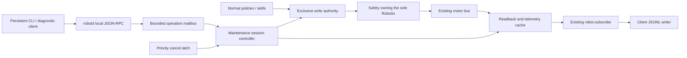

# All-motor diagnostics and raw maintenance v1

**v1 implementation contract.** This page owns diagnostic sessions and their API.
[robotd-design.md](robotd-design.md) owns normal control and bus mechanisms;
[architecture.md](architecture.md) owns service/transport authority. This revision narrows v1
following a read-only Claude Code scope review of `b3841c5`. The implementation follows the
session semantics below; see [the operator guide](../robot/diagnostics.md) for actual commands.

## 1. Scope

Provide a direct, observable maintenance interface for **all 15 motors**, including mouth,
through one execution path. No joint has a privileged implementation or commissioning order.
The operator chooses physical support and target angles; no policy or anatomical protection
modifies those commands. Motor testing and calibration are different operations.

### Included in v1

- All-motor inventory, cached register inspection, bounded read-only refresh and status.
- A local, connection-bound exclusive `maintenance_raw` session.
- Selected-joint absolute position commands, selective torque and RAM position P/I/D gains.
- Explicit stop/cancel, per-command expiry, lease expiry and a recoverable unconfirmed-stop latch.
- Existing `robot.subscribe` telemetry extended with a maintenance block; recording on the client.
- One persistent `robotctl diagnose session` process, interactive or scripted.

### Deferred

No experiment/suite engine, prepare/arm/run pipeline, robot-side recorder/export/report service,
passive event-triggered recorder, multi-service support bundle, camera orchestration, statistical
summaries or vetbook integration. Scripts can implement finite experiments and record existing
telemetry without adding execution machinery in robotd. Relative commands are deferred: the
client can inspect and compute an absolute target explicitly. No hardware watchdog integration
in v1; document measured host-loss behaviour without claiming a guarantee.

EEPROM calibration, native limit/shutdown changes, operating-mode switching and additional
current/PWM/velocity control modes are separate future designs. A stalled servo can be recovered
through the existing reboot path **after confirmed session release**, then reacquired; no new
in-session reboot or automatic error clearing.

### Raw means raw

Policies, balancing, pickup pause, fall reactions, anatomical clamping, collision avoidance and
automatic recovery do not generate, alter or block maintenance targets. Pickup/fall observations
can remain visible but must say they are not enforced. No posture-qualified fixture profile,
support/lift classifier, camera readiness or hold-to-run is required.

Native servo restrictions and electrical/thermal shutdown remain unchanged. Protocol validity,
exclusive authority, explicit stop and connection-loss termination still apply. No silent
clipping or software slew limiting of raw targets; inspect native servo profile velocity and
acceleration because native smoothing may still exist. Valid protocol input is not a promise
of mechanical clearance. Entry acknowledges the raw contract once; there is no per-command
confirmation. Normal operation retains its existing behaviour and protection configuration.

The inspected baseline is 0.17.9, `96b89d8613f06722c1d64ce75ab0d7124fed9d8f`, API 44. It has
joint telemetry but no isolated actuator API; init moves all joints, and skill execution is
policy-driven. Short asymmetric walking observations motivate diagnostics but identify neither
a bad mechanical zero nor a failed motor.

## 2. Concrete implementation seam



The current `RobotIo::write` writes all JOINT_IDS, `set_gain` writes every servo and forces
I=D=0, and the normal loop calls `Safety::apply` every tick. They cannot implement selective raw
commands as-is. This refactor is required, not conditional:

1. Extend RobotIo with selected-ID goal writes, selected torque, per-ID P/I/D read/write and
   goal/torque/gain readback. Return honest operation-specific outcomes. Extend FakeIo to keep
   state and write counters **per motor**, rather than global torque/gain values.
2. Keep Safety's sole RobotIo handle. Add a maintenance-only operation path reachable only
   under the explicit maintenance authority; it uses protocol validation, not normal clamping.
3. During maintenance and unresolved stop faults, continue sensing/observation but skip normal
   `gate`/`apply` and all policy/skill/power target generation. Normal targets and global gains
   must never overwrite maintenance state. Do not spoof sensors or modify persistent pickup flags.
4. IPC tasks validate shape/credentials and enqueue bounded operations. Only the bus-owning
   control thread commits authority and performs serial I/O. Stop/cancel uses a separate priority
   latch, not a mailbox slot that can be exhausted by ordinary commands.

No new daemon, UART handle or network listener. Snapshot refresh schedules bounded reads by the
same bus owner; RPC threads never run a register scan. Preserve values already read before
startup register correction alongside expected/after values. inspect/refresh never call the
correcting startup function. Per-field timestamp/status distinguishes desired, observed, stale,
unavailable and failed values. Additional reads have a measured bus budget and must not hold up
the 50 Hz tick. No file/network work in the motor tick.

## 3. Inventory and command semantics

Use duck-ipc-proto JOINT_NAMES/JOINT_IDS directly, independently of the 14-action policy vector.

| Motor | Bus ID |
|---|---:|
| `left_hip_yaw` | 20 |
| `left_hip_roll` | 21 |
| `left_hip_pitch` | 22 |
| `left_knee` | 23 |
| `left_ankle` | 24 |
| `neck_pitch` | 30 |
| `head_pitch` | 31 |
| `head_yaw` | 32 |
| `head_roll` | 33 |
| `mouth` | 34 |
| `right_hip_yaw` | 10 |
| `right_hip_roll` | 11 |
| `right_hip_pitch` | 12 |
| `right_knee` | 13 |
| `right_ankle` | 14 |

All motors support the same inspection/torque/PID/position schema when the backend supports it.
Missing motors remain listed with a reason. Position is absolute radians in the existing runtime
coordinate system; raw encoder counts are exposed separately for inspection. The homing already
affects present position: do not add or subtract it a second time. No joint-specific client math.

Multiple selected motors may receive targets in one sync write. Non-selected goal, torque and
gain registers are untouched. Reject unsupported selection rather than writing all fifteen.
V1 requires the expected position operating mode and publishes its native register ranges.
NaN/infinity, unknown/duplicate joints and unrepresentable values are rejected before sending;
representability checks are not anatomical limits. Distinguish hardware readback from assumptions
about what the servo accepted. Do not claim a generic +/-pi range is the native range in all modes.

### Entry, ownership and torque-on hold

Acquire requires `enabled=false`, no active controller/bringup/skill/shutdown sequence, no pending
power/skill intent, and fresh **torque-enable readback off for all 15 motors**. Held/Ready without
an enabled policy is not sufficient if torque is on. Any on/unknown value refuses with `torque_on`
or `torque_unknown` and named motors. The operator can explicitly use existing robot.relax first.
These are authority/state preconditions, not pickup or posture checks. Acquisition never relaxes,
homes, moves, enables torque or automatically adopts powered joints.

All 15 drive modes must also be known with bit 3 (`0x08`) clear. On XL330 firmware 46+
[Drive Mode(10), Torque On by Goal Update](https://emanual.robotis.com/docs/en/dxl/x/xl330-m288/#drive-mode10)
can energize a motor when a goal is written, including during seeding or normal-goal restoration.
Unknown modes or this bit refuse acquisition with `unsupported_drive_mode` and named motors;
selected torque-on rechecks the fresh mode before seeding. No EEPROM settings are changed.

After admission, clear pending normal intents and bind exclusive ownership to peer credentials,
originating connection and daemon boot epoch. A session ID identifies this session; no extra
token is necessary. Reconnecting can inspect status but cannot resume ownership or replay motion.

Torque-on is explicit and selected. For each selected off motor: read a fresh position, seed its
goal with that measured coordinate, verify goal readback within conversion quantization, then
enable torque and read back torque state. Failure skips enabling that motor. That initial hold
is bounded by the session lease alone; it is not a position command with a second expiry timer.
Never re-enable or reseed an already-on motor as a side effect of a repeated on request.

The controlled set includes every motor confirmed enabled by the session and every motor whose
enable outcome is uncertain. Keep uncertain motors in that set until confirmed off. Status exposes
this set, its uncertainty and per-motor torque readback. Starting all-off makes stop ownership
unambiguous; no prior torque is restored on exit.

### Position validity and lease

The lease is the only session-liveness clock. Suggested default: keepalive every 100 ms, expiry
after 300 ms, server-monotonic time; measure scheduling tolerance before shipping. A stale or
non-increasing keepalive sequence is rejected and does not renew the lease. Connection close,
lease expiry or explicit release stops **the full controlled set** and closes the session.

Each accepted position command has `valid_for_ms`, initially 1..60000. Its server deadline starts
when the control thread commits it, not at request arrival. Expiry cuts torque **only on motors
whose latest accepted target still belongs to that command**; it does not cut an unrelated head,
mouth or leg hold. A later target supersedes expiry independently per selected motor. Keepalive
does not extend target validity; a new command can. Torque-on holds with no subsequent target
remain lease-bounded. Torque-off clears the selected target deadlines. No implicit re-enable.

### Partial outcomes and stopping

No atomic multi-servo transaction or automatic rollback. A request attempts all selected motors
and returns individual outcomes; one gain/enable failure does not stop unrelated motors:

| Operation | Failure/verification semantics |
|---|---|
| Goal sync write | Transport success is `sent`, not acknowledgement by each servo. Optional scheduled goal-register readback can later report `readback_confirmed` or `mismatch`; neither proves physical arrival. Send failure is `write_failed`/delivery unknown. |
| Gain write | Read back all requested P/I/D registers. On failure report unknown/partial values; no implicit torque change. A retry rereads and repairs only explicitly requested settings. |
| Torque-on | If seeding/readback fails, leave that motor off and report it. If enable or torque readback is uncertain, attempt off, retain it in the controlled set and enter stop-unconfirmed handling if off cannot be verified. |
| Torque-off | Attempt each selected motor, then verify off. Any unconfirmed off creates a fault latch; do not report success from a sent packet alone. |

Uncertain command delivery is logged; it does not invent a confirmed per-ID result from a
broadcast. The caller can inspect or stop. Native servo error/status remains visible; no automatic
reboot, homing or recovery movement. Explicit stop stops the entire controlled set, clears its
pending targets and leaves the same live session acquired if off is confirmed. It never returns
to a previous pose. Command expiry uses the narrower set above.

Stop confirmation can fail. Keep a daemon-level `stop_unconfirmed` inhibit **separate from the
connection-bound session**: it prevents normal writes/new acquisition even after the client
disconnects, records affected motors, and survives session closure until off is confirmed.
`release` is always admitted from faulted and retries stop; connection loss closes the session
and performs the same stop attempts, without making the inhibit disappear. A new authorized
local `cancel` or existing robot.relax can retry off without reviving the session. Successful
readback clears the inhibit; unreachable hardware remains explicitly unresolved, not an orphaned
session requiring a daemon restart. No automatic return to normal writes while off is unconfirmed.

### Existing calls and exit

| Existing operation during ownership or stop inhibit | Behaviour |
|---|---|
| Health, model, mode reads, robot.subscribe | Continue as read-only operations |
| robot.relax, including the existing pad/transport relax action | Retain current authorization/transport reachability; terminate the session and attempt all-joint torque-off. Report outcome and retain inhibit if unconfirmed. |
| robot.stop | Refuse `diagnostic_owned`; zeroing walking twist is not a maintenance stop. Use diagnostics.stop/cancel or relax. |
| init, enable, move, head/look/pose/mouth, skills, mode changes, policy loads, rest, shutdown and rebootMotors | Refuse `diagnostic_owned`; discard/count notifications instead of queuing them for exit. Relax first if a subsequent rest/shutdown/reboot is wanted. |

Do not add new uid restrictions to existing relax or other normal-mode calls. New maintenance
mutations have their own authorization below. Sound/light readouts can continue only when they
do not initiate actuator/owner transitions. Centralize actuator admissions so a handler does not
quietly modify intent/config and return success during the session.

Confirmed exit sets bringup=Limp, enabled=false, clears pending control/skill/power requests,
forgets skill/controller state, invalidates gain caches, and seeds the normal hold from fresh
known positions. If fresh position data is unavailable, remain write-inhibited until available.
The first subsequent normal apply tick may rewrite normal global P/I/D with torque off; this is
not delayed until the next enable. Only a new explicit normal enable may energize motors again.
Never resume old intent or issue normal goal/gain writes before confirmed off. Normal-mode
protection configuration/features are unchanged throughout.

Check maintenance/inhibit **before** safeToRestart's fallen/moving shortcuts. Report unsafe
through ownership and any unresolved inhibit, even when the robot is lying down. This does not
protect against a hung process or power loss: v1 documents measured native host-loss behaviour;
servo watchdog integration is deferred.

## 4. Minimal local API

JSON-RPC 2.0 on /run/robotd.sock, typed in duck-ipc-proto, API_VERSION 45. Install the whole
daemon release so robotd, robotctl and the transport route tables share this contract.

| Method | Request | Result/effect |
|---|---|---|
| `robot.diagnostics.capabilities` | `{}` | All 15 motor/ID entries, backend support, position/PID representation and refresh budgets |
| `robot.diagnostics.inspect` | `{}` (complete cached snapshot) | Immutable cached snapshot, boot epoch and field-level observation times/status |
| `robot.diagnostics.refresh` | Request ID (refreshes the motor inventory) | Bounded scheduled read, no correction/write; operation ID/outcome in status |
| `robot.diagnostics.status` | `{}` | Current owner/session, lease, controlled set, readback, last outcomes and independent stop inhibit |
| `robot.diagnostics.acquire` | Monotonic request ID, `mode:maintenance_raw`, `acknowledge_raw:true` | Commit exclusive ownership with entry checks; returns session ID, lease duration and snapshot |
| `robot.diagnostics.torque` | Session ID, request ID, joints, `on:bool` | Selective seeded torque-on or verified torque-off |
| `robot.diagnostics.gains` | Session ID, request ID, map joint→`{p,i,d}` | Per-joint RAM PID write/readback; require complete triplets of raw unsigned register integers |
| `robot.diagnostics.command` | Session ID, request ID, positions_rad map, valid_for_ms | Selected absolute targets and per-motor expiry |
| `robot.diagnostics.keepalive` | Session ID, increasing keepalive sequence | Renew only this connection's lease |
| `robot.diagnostics.stop` | Session ID, request ID | Priority stop full controlled set; retain live session when confirmed |
| `robot.diagnostics.release` | Session ID, request ID | Stop and close, with confirmed-off exit or independent inhibit |
| `robot.diagnostics.cancel` | Request ID | Authorized administrative stop/close or inhibit recovery from a different local connection |

No token, diagnostics.subscribe, arm, prepare/run, relative command, record/export/report or
in-session reboot API in v1. Keep read-only inspect/status available without session ownership.
Refresh is globally rate-limited to protect the bus budget; no general register-address RPC.

PID values are raw u16 registers, not physical SI gains; capabilities publishes the actual
model-specific accepted P/I/D ranges and the server validates them before writes. Each selected
motor requires a complete triplet so an unseen old I/D value is not silently retained. RAM changes
are not persisted to configuration. Native operating/drive modes, profile velocity/acceleration,
limits, goal position, torque and gains are inspected explicitly, with unsupported values marked
unavailable. Existing current magnitude semantics remain unchanged; signed current/PWM can be
additional fields from the already-read fast block without affecting policy/pickup features.

### Delivery, identity and bounded retry

A mutation response distinguishes queued from committed/failed and includes operation sequence,
commit tick, per-motor sent/readback/failed states and observation times. No sync-write result is
labelled native refusal unless an actual status/readback provides that evidence. Clients inspect
status after an uncertain acknowledgement instead of blindly re-running commands.

Use strictly increasing u64 request IDs per session, a high-water mark and a bounded cache of
the last 256 outcomes/payload digests. Cached same ID/same payload returns the prior result;
changed payload is request_conflict. An older evicted ID returns request_expired and never
executes again. Invalid out-of-order IDs do not advance motion. keepalive has its own sequence.
A duplicate acquire on the owning connection returns its existing outcome; acquisition while
already owned is busy. Administrative cancel uses connection-local monotonic IDs and is naturally
idempotent. All pending/outcome storage is bounded. Define exact sizes/timeouts as implementation
constants, not unbounded per-client maps.

```json
{
  "jsonrpc": "2.0", "id": 7, "method": "robot.diagnostics.command",
  "params": {
    "session_id": "session-opaque", "request_id": 7,
    "positions_rad": {"head_roll": 0.05}, "valid_for_ms": 500
  }
}
```

This illustrates the schema, not an approved physical target. It requires explicit previous
torque-on for that selected motor. Goal writes never enable torque implicitly. Every canonical
motor name including mouth uses the same shape. Reject unknown fields/joints, duplicate map keys,
NaN/infinity, unsupported modes and native-unrepresentable values before enqueueing I/O.

### Authorization and transport

robotd uses a maintenance-only counterpart of configd's Unix peer mutation policy. The
policy applies to **new diagnostic mutations only**: daemon owner plus named maintenance users, unavailable peer credentials denied. Separate this from the socket's existing 0660 group
reachability. Provision the operator's local account explicitly; do not grant maintenance to a
shared relay group. Known mediad/btd relay uids are explicitly denied before user grants;
record requesting credentials in outcomes. Do not assume a local relay is a local mechanic.

Add explicit false arms for maintenance methods to btd/mediad exhaustive route tables and check
any Space/console proxy paths. Do not restrict existing read/relax routes as a side effect.
Authorized local SSH executes the CLI; no new HTTP/UDP API. Read-only inspect/capabilities/status
are ungated beyond socket access, matching existing conventions; refresh is a quota-limited read.

## 5. CLI and telemetry

Standalone commands: `robotctl diagnose inspect --json`, `capabilities`, `status`, `watch` and
`cancel`. watch consumes **robot.subscribe**, not a second diagnostics stream. cancel opens a
new authorized connection and invokes administrative cancel, not an owner-only stop.

Use one persistent process for active operations:

```text
robotctl diagnose session --mode maintenance-raw
# commands read on this process's stdin:
torque head_roll on
gains head_roll p=100 i=0 d=0
position head_roll rad=0.05 valid_for_ms=500
stop
release
```

Syntax implemented by this v1. The process acquires once with explicit raw
acknowledgement, owns the connection and sends keepalive while running. Interactive input or
scripted stdin use the same contract; no per-command confirmation or hold-to-run. EOF releases,
Ctrl-C cancels/releases, and Ctrl-Z suspension permits the lease to expire. The CLI must not
leave a separate heartbeat process alive after its owner is suspended or exits. A fresh terminal
uses cancel rather than borrowing the old session ID. CLI gain units/valid_for_ms names match
the wire. Explicit deg input can convert to canonical radians without changing the server API.

Extend RobotState with an optional maintenance block: mode/session, controlled torque set and
readback, per-joint PID state, latest command/write result, lease/deadlines, stop inhibit, and
pickup/fall enforcement status `false`/maintenance_raw. Preserve normal RobotState semantics;
expose maintenance received/written targets distinctly so a viewer does not mistake a desired
value for a successful physical response. Keep frames timestamped/sequenced with freshness/drop
information. A sensor reading in tick n precedes the newly written target in tick n: include the
previous successful command sequence for response analysis.

The client can record this stream to JSONL with `session --record PATH` or `watch` redirection,
and mutation outcomes on stdout to a separate JSONL file using robot monotonic time/boot
epoch and optional wall-clock labels. Slow registers have their own observation timestamps;
null is not zero. A slow subscriber/disk writer drops or marks incomplete client evidence without
blocking robotd or changing raw motor commands. No server disk retention/exports to implement.
Camera capture/synchronization and statistics can be independent tools later; neither is a gate.

## 6. Implementation and tests

| Slice | Result | Files/seams |
|---|---|---|
| 1. Inspection | All-15 inventory, readback including torque/goal/PID/native profiles, bounded refresh, startup preimages | duck-control/src/{io,bus}.rs; duck-ipc-proto/src/{lib,diagnostics}.rs; robotd/src/diagnostics.rs |
| 2. Raw controller | Required selective operations, exclusive Safety-owned I/O path, entry/exit/inhibit rules and local authorization | duck-control/src/safety.rs and FakeIo; robotd/src/{main,intents,diagnostics}.rs; configd PeerPolicy pattern; deployment maintenance grant |
| 3. API/CLI | Typed methods, existing stream extension, persistent session/client JSONL and route exclusions | robotctl, duck-ipc-proto, mediad/src/route.rs, btd/src/route.rs; API/version/docs tests |

Parameterize all motor operation tests over exact JOINT_NAMES/JOINT_IDS, independently of policy
action order. FakeIo tracks per-ID torque/goals/PID and normal versus maintenance write counts.
Assert no normal gate/apply/global-gain write while owned or inhibited, selected sync-write IDs
only, no accidental mouth/head command path, unchanged homing conversion, and normal protections
outside maintenance. No special knee code or priority.

Test admission with any torque on/unknown, enabled/pending intent races, two clients, acquire
without movement, stale/readback-seeding failures, already-on repeat, complete PID range checking,
partial operations, sent-versus-readback outcomes, request replay/eviction, per-command expiry
superseded on only part of its joint set, and no unrelated motor torque-off. Cover lease expiry,
Ctrl-Z-equivalent loss, connection close and stop priority with a full ordinary mailbox.

Test release/relax/cancel from every state including faulted after disconnect; independent inhibit
recovery from a new connection; confirmed-off postconditions, enabled reset/Limp/controller forget,
normal gain rewrite on the next tick and no automatic torque enable. A false/missing off readback
must not open the normal write path. Check safeToRestart before fallen shortcuts. Exercise every
existing actuator method's admission table, including rejected notifications being cleared.

Check mutation peer policy and relay uid refusal, actual transport route arms, JSON roundtrips,
field units, bounded buffers and refresh cost. No pickup/fall/support/IMU-classifier or camera
readiness refusal in raw operation; native transport/value/mode failures remain explicit.

Bench validation measures selective torque/gain/goal readback, command/lease stop timing, partial
bus failures and native host-loss behaviour for all 15 motors with operator-selected setups.
Existing reboot recovery is release → rebootMotors → relax/readback → fresh acquisition.
Simulation checks message/coordinate/timing behaviour, not physical clearance, backlash or friction.
Do not promise stop-on-process-crash until separately implemented and measured. No servo watchdog
or new protection qualification framework is required to land this v1.

## 7. Fixed choices and remaining implementation details

Fixed for v1: all-off readback acquisition; one connection/session; no redundant token; selected
raw goals/torque/full-triplet RAM PID; per-command expiry affecting only its latest selected
motors; lease/stop/release affecting the controlled set; existing relax unchanged; independent
stop inhibit recoverable by local cancel; persistent CLI; existing telemetry/client recording.
Calibration writes, other operating modes, helpers/suites/camera/robot-side reports are deferred.

The implementation pins model-specific native ranges, bounded refresh/mailbox time budgets, permission deployment
and telemetry payload sizes from the existing hardware/code. Lease defaults and actual stop/host-loss
behaviour need bench measurement; they do not reopen the agreed raw-mode scope or add behavioural
protection gates. Later persistent calibration would require an explicit source of truth shared
by startup/adoption/maintenance and its own interruption/rollback design.
